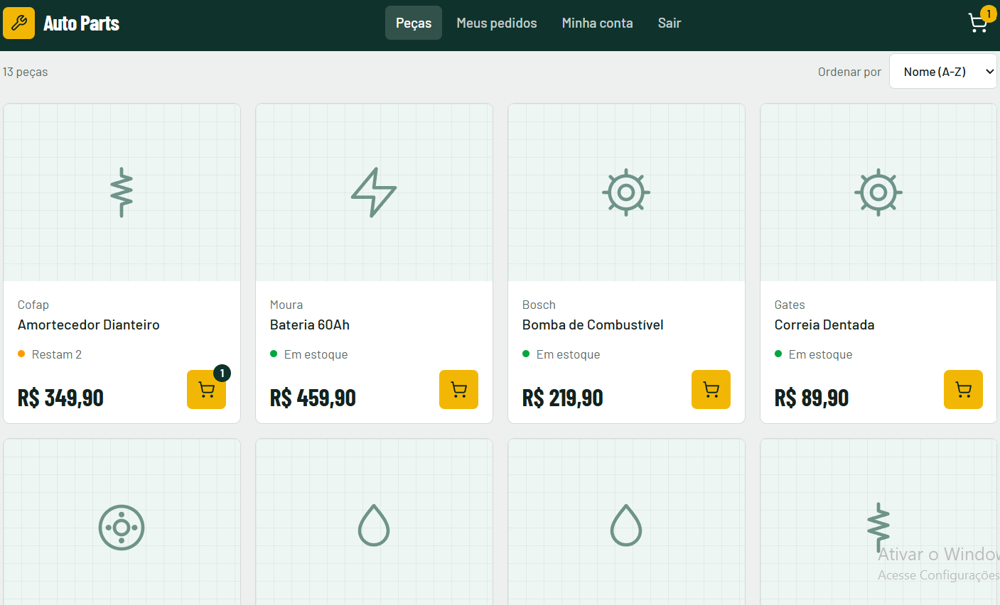
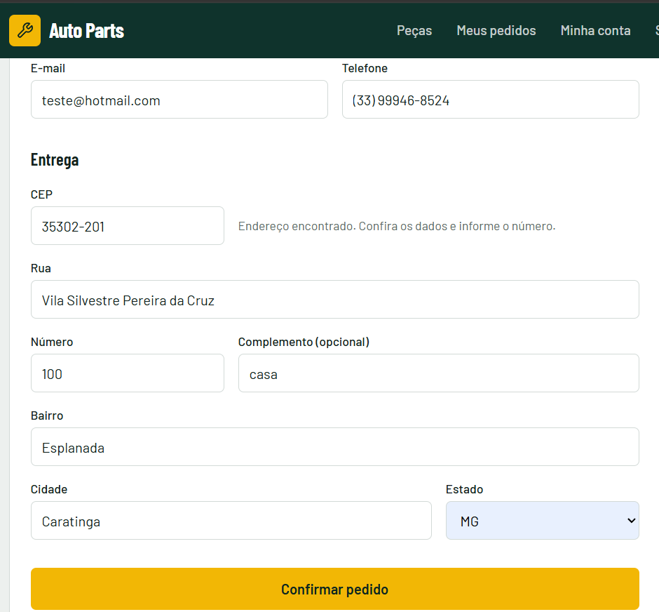
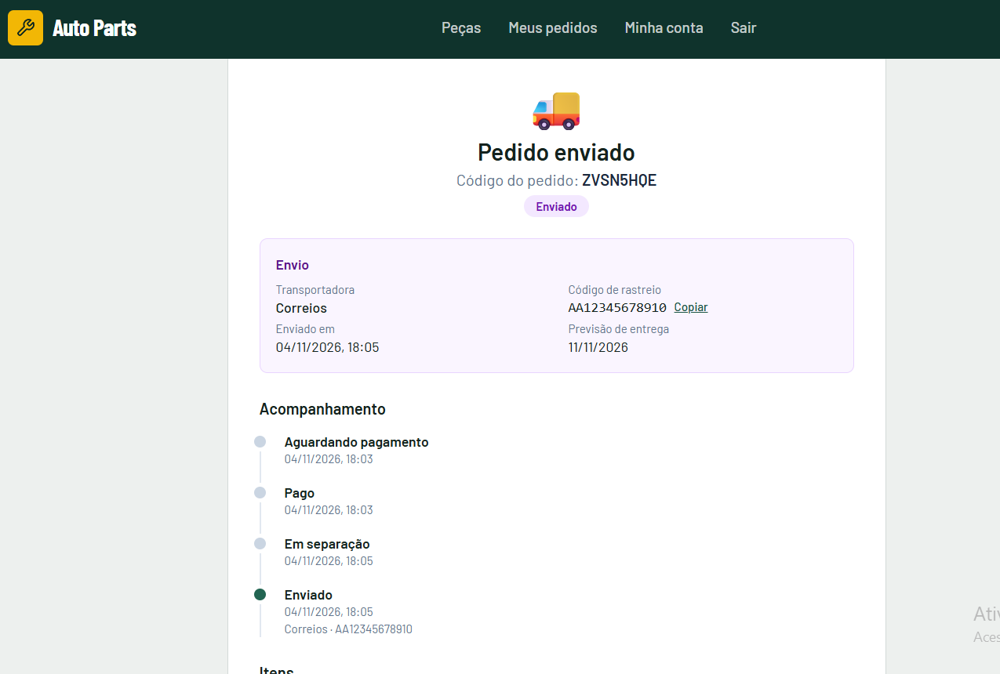
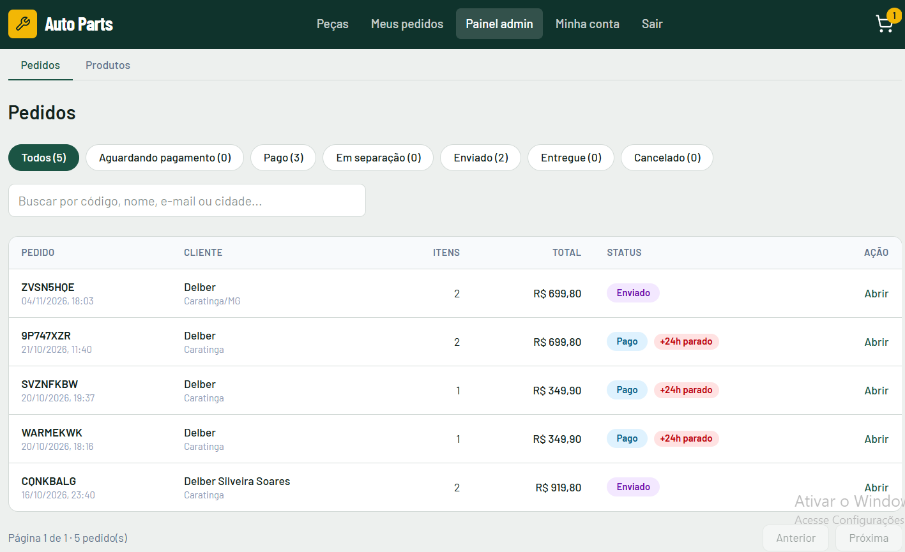
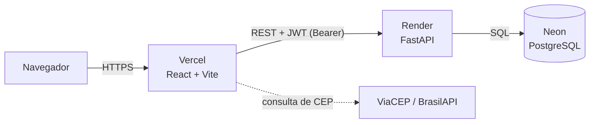

# Auto Parts (frontend)

Loja de autopeças full stack, feita como projeto de portfólio: catálogo com busca, carrinho, checkout com preenchimento de endereço pelo CEP, pedidos com acompanhamento de envio e painel administrativo para produtos e pedidos.

Este repositório é o **frontend**. A API (FastAPI + PostgreSQL) está em [auto-parts-backend](https://github.com/delberssoares/auto-parts-backend).


**Demonstração:** https://auto-parts-frontend-ten.vercel.app
**Documentação da API (Swagger):** https://SEU-SERVICO.onrender.com/docs

> A API roda no plano gratuito do Render e "dorme" após 15 minutos sem acesso. Na primeira visita depois de um tempo parado, as peças podem levar até 1 minuto para aparecer. As visitas seguintes são rápidas.

## Sumário

- [Funcionalidades](#funcionalidades)
- [Capturas de tela](#capturas-de-tela)
- [Stack](#stack)
- [Arquitetura](#arquitetura)
- [Decisões técnicas](#decisões-técnicas)
- [Como rodar localmente](#como-rodar-localmente)
- [Variáveis de ambiente](#variáveis-de-ambiente)
- [Estrutura do projeto](#estrutura-do-projeto)
- [Qualidade](#qualidade)
- [Deploy](#deploy)
- [Modo demonstração e limitações](#modo-demonstração-e-limitações)
- [Roadmap](#roadmap)
- [Autor](#autor)

## Funcionalidades

**Cliente**

- Catálogo com busca por nome ou marca, filtro por categoria e ordenação. O estado dos filtros fica na URL.
- Página do produto com seletor de quantidade e situação do estoque.
- Carrinho persistente no navegador, limitado pelo estoque disponível.
- Checkout com validação (React Hook Form + Zod), máscaras de telefone e CEP e **preenchimento automático do endereço pelo CEP** (ViaCEP, com BrasilAPI como reserva).
- Pagamento simulado (Pix ou cartão).
- Meus pedidos com filtros, cancelamento (com estorno simulado quando o pedido já estava pago), **linha do tempo** do pedido e código de rastreio.
- Conta: cadastro, login, troca de senha e recuperação de senha por link.

**Administrador**

- Gestão de produtos (criar, editar e excluir), com exclusão otimista e pré-visualização da imagem.
- Fila de pedidos com contadores por status, busca, paginação feita no servidor e alerta de pedidos parados há mais de 24 horas na mesma etapa.
- Detalhe do pedido com as ações permitidas para o status atual: iniciar separação, informar envio (transportadora, código de rastreio e previsão) e marcar como entregue. O cancelamento devolve o estoque.

**Plataforma**

- Layout responsivo, pensado primeiro para o celular.
- Acessibilidade: foco visível, link "Ir para o conteúdo", avisos com `aria-live` e rótulos nos formulários.
- Sessão por JWT, revalidada ao abrir o app. Uma resposta `401` encerra a sessão local.
- Estados de carregamento, erro e lista vazia em todas as telas de dados.

## Capturas de tela

| Catálogo | Checkout com busca de CEP |
|:--:|:--:|
|  |  |
| **Pedido com linha do tempo** | **Painel de pedidos (admin)** |
|  |  |

## Stack

| Área | Tecnologias |
|---|---|
| Interface | React, TypeScript, Vite, Tailwind CSS v4 |
| Rotas | React Router |
| Dados do servidor | TanStack Query (cache, invalidação, atualização otimista) |
| Estado do cliente | Zustand (carrinho e sessão, com persistência) |
| Formulários | React Hook Form + Zod |
| Qualidade | ESLint, TypeScript estrito, GitHub Actions |
| Hospedagem | Vercel (front), Render (API), Neon (PostgreSQL) |

## Arquitetura



Dentro do frontend, cada camada tem uma responsabilidade:

```
pages  ->  hooks (TanStack Query)  ->  services  ->  lib/api (fetch)  ->  API
              ^
              |
        store (Zustand): carrinho e sessão
```

- **pages**: telas e composição de componentes.
- **hooks**: encapsulam as consultas e mutações, com chaves de cache e invalidação.
- **services**: uma função por endpoint, tipada. É o único lugar que conhece as rotas da API.
- **lib/api**: cliente `fetch` com token, erros tipados (`ApiError`) e tratamento de `401`.
- **store**: só estado que pertence ao navegador (carrinho e sessão). Dados do servidor ficam no cache do TanStack Query.

## Decisões técnicas

- **Camada de serviços isolada.** O projeto começou com serviços simulados em `localStorage` e foi migrado para a API real sem alterar as telas, porque elas só dependem dos hooks.
- **O front nunca decide preço nem total.** O carrinho envia apenas `product_id` e `quantity`. O servidor busca o preço no banco, calcula o total e baixa o estoque.
- **Estado do servidor separado do estado do cliente.** TanStack Query cuida de produtos e pedidos. Zustand cuida só do carrinho e da sessão.
- **Regras de status do pedido em um único lugar** (`src/lib/orderStatus.ts`). Os botões do admin vêm do mapa de transições, então mudar uma regra atualiza a tela sozinha. A API valida as mesmas transições, e o front é só espelho.
- **Exclusão otimista com rollback.** Ao excluir um produto, ele some da lista na hora. Se a API recusar, a lista volta ao estado anterior.
- **Erros tratados de ponta a ponta.** A API devolve sempre `{"detail": "mensagem"}`. O `ApiError` carrega status e tempo de espera (`429`), e as telas mostram a mensagem do servidor.
- **Sessão revalidada.** Ao abrir o app, o token é conferido em `/auth/me`. Dados da conta (pedidos) saem do cache quando a sessão termina, para não vazar entre usuários.
- **Busca de CEP com plano B.** Se a ViaCEP falhar, o app tenta a BrasilAPI. Os campos continuam editáveis, então o cliente nunca fica bloqueado se os dois serviços caírem.
- **Identidade visual própria.** Tema com tokens no Tailwind (verde corrida para a marca e latão reservado para ações), tipografia Barlow e ícones por categoria quando a peça não tem foto.

## Como rodar localmente

Pré-requisitos: **Node.js 22+** e a API rodando (veja o [repositório do backend](https://github.com/delberssoares/auto-parts-backend)) ou a URL da API publicada.

```bash
git clone https://github.com/delberssoares/auto-parts-frontend.git
cd auto-parts-frontend
npm install
cp .env.example .env.local
npm run dev
```

O app abre em `http://localhost:5173`. Com a API local em `http://localhost:8000` (valor padrão de `VITE_API_URL`), não é preciso editar nada.

| Script | O que faz |
|---|---|
| `npm run dev` | Servidor de desenvolvimento |
| `npm run build` | Verificação de tipos e build de produção |
| `npm run lint` | ESLint |
| `npm run preview` | Serve o build gerado |

## Variáveis de ambiente

As variáveis `VITE_*` são embutidas no código no momento do build e ficam visíveis no navegador. Nunca coloque segredos nelas.

| Variável | Obrigatória | Descrição |
|---|---|---|
| `VITE_API_URL` | Sim (em produção) | URL base da API, sem barra no final. Padrão: `http://localhost:8000` |
| `VITE_DEMO_MODE` | Não | Com valor `true`, mostra no cadastro o aviso de ambiente de demonstração |

## Estrutura do projeto

```
src/
├── components/   Layout, cartão de produto, badges, linha do tempo, modal de envio...
├── hooks/        useProducts, useOrders, useAdminOrders, useSessionSync, useCepLookup...
├── lib/          api.ts, orderStatus.ts, schemas Zod, máscaras, formatadores
├── pages/        telas (catálogo, produto, carrinho, checkout, pedidos, conta, admin...)
├── services/     authService, productsService, ordersService, cepService
├── store/        authStore e cartStore (Zustand com persistência)
└── types/        tipos do domínio, alinhados ao contrato da API
```

## Qualidade

- **CI** (GitHub Actions): a cada push na `main` e `develop` e em cada pull request para a `main`, roda lint, verificação de tipos e build.
- **Fluxo de branches**: `develop` para integração e `main` como produção, com merge por pull request.
- **Testes automatizados** do frontend estão no [roadmap](#roadmap).

## Deploy

O frontend é publicado na **Vercel**, com deploy automático a cada push na `main`.

1. Importe o repositório na Vercel (preset Vite).
2. Em **Environment Variables**, defina `VITE_API_URL` com a URL da API no Render (sem barra no final) e, se quiser o aviso de demonstração, `VITE_DEMO_MODE=true`.
3. Faça um redeploy, pois variáveis do Vite só entram no build.
4. O arquivo `vercel.json` reescreve todas as rotas para o `index.html` (para recarregar páginas como `/pedidos` sem erro 404) e desativa cache e envio de `Referer` na tela de redefinição de senha, que carrega um token na URL.

A API precisa ter a URL do front em `FRONTEND_URL` para liberar o CORS e montar os links de e-mail.

## Modo demonstração e limitações

- **Pagamento simulado.** Nenhum pagamento real é processado.
- **Recuperação de senha.** O envio de e-mail depende de um domínio verificado em um provedor. Por isso, na demonstração, contas criadas pelo cadastro público são marcadas como contas de teste e, nelas, o link de redefinição aparece direto na tela, sem e-mail. Contas administrativas e reais continuam no fluxo normal. Use dados fictícios e não reutilize uma senha sua.
- **Acesso administrativo.** As credenciais do admin não são públicas, para que ninguém altere o catálogo e os pedidos da demonstração. Os prints acima mostram o painel.
- **Primeira visita lenta.** O plano gratuito do Render coloca a API para dormir. Veja o aviso no início deste README.
- **Token no `localStorage`.** É uma escolha comum em projetos como este, mas expõe o token a ataques de XSS. Em produção real, o ideal é cookie `httpOnly` ou token de curta duração com refresh.
- **Imagens.** O catálogo usa um ícone por categoria quando a peça não tem foto.

## Roadmap

- [ ] Testes com Vitest e Testing Library (carrinho, checkout, regras de status) e teste de ponta a ponta com Playwright
- [ ] Compatibilidade por veículo (marca, modelo e ano) com o selo "Serve no seu carro"
- [ ] Frete e prazo por CEP
- [ ] Dashboard do admin (vendas, ticket médio e pedidos por status)
- [ ] Impressão da lista de separação e exportação de pedidos em CSV
- [ ] Upload de fotos dos produtos
- [ ] Pagamento em modo de teste (Mercado Pago ou Stripe) com webhook
- [ ] Tipos do front gerados a partir do OpenAPI da API

## Autor

Feito por [@delberssoares](https://github.com/delberssoares). Sugestões e correções são bem-vindas por [issues](https://github.com/delberssoares/auto-parts-frontend/issues).